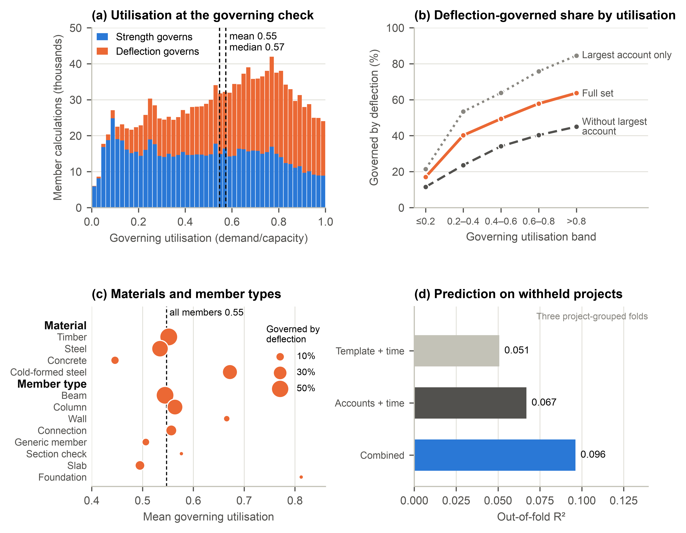
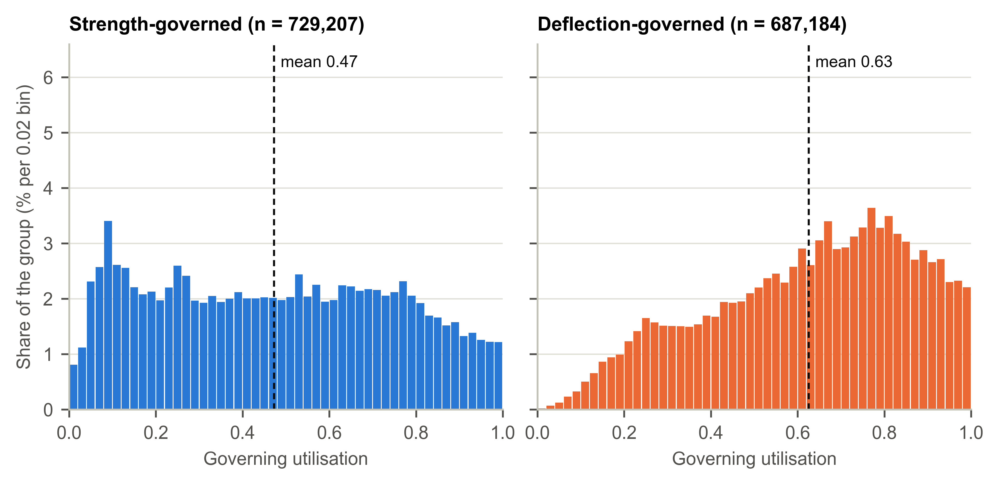
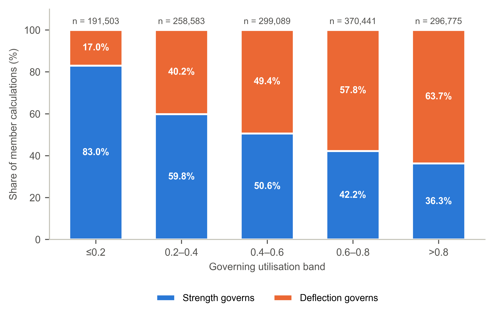

# Strength to Spare, Deflection at the Limit

### Governing Utilisation in 1.4 Million Structural Member Calculations

*Figures and supplementary material*

How much of their designed capacity do structural members use in everyday practice? This repository holds the figures and supplementary material for a study of **1,416,391 governing member calculations with valid utilisation ratios up to unity**, made on the Calcs.com platform between January 2024 and June 2025 by 3,073 engineer accounts in 1,735 organisations. The calculations cover timber, steel, cold-formed steel and concrete, checked to Australian, US and Canadian standards. The paper is in preparation and has not yet been peer reviewed.

## What the study found

- **About half of the capacity is used.** Mean governing utilisation in the retained records was 0.547. One calculation in five exceeded 0.8, and one in nine was strength-governed at 0.2 or less.
- **Serviceability binds the tightly sized members.** Deflection governed 17.0% of calculations in the lowest utilisation band and 63.7% in the highest, and the shift held within calculators.
- **Practice leaves a signature.** Recorded account and organisation identifiers improved prediction beyond calculator and creation month, lowering mean squared prediction error on withheld projects by 4.8% (8.6–8.9% with the dominant organisation excluded or capped).

## Figures

Each figure is available as a PNG and as a vector PDF.

**Figure 1. Governing utilisation of strength-governed (n = 729,207) and deflection-governed (n = 687,184) member calculations.** The two panels partition one distribution of governing values; each panel is normalised within its governing group.
[PNG](figures/figure_1_governing_utilisation_by_check.png) · [PDF](figures/figure_1_governing_utilisation_by_check.pdf)

**Figure 2. Share of member calculations governed by strength and by deflection, by governing utilisation band.** Bands exclude their lower bound and include their upper bound.
[PNG](figures/figure_2_governing_check_by_utilisation_band.png) · [PDF](figures/figure_2_governing_check_by_utilisation_band.pdf)

**Figure 3. Key findings at a glance.** (a) Governing-utilisation distribution by governing check. (b) Deflection-governed share across bands for the full set and largest-organisation sensitivities; “account” denotes an organisation. (c) Mean utilisation by material and member type; marker size indicates the deflection-governed share, with a minimum size for zero shares. (d) Full-set out-of-fold R² for template, account and combined models, all including creation month, using three project-grouped folds.
[PNG](figures/figure_3_key_findings_at_a_glance.png) · [PDF](figures/figure_3_key_findings_at_a_glance.pdf)

## Supplementary material

| Item | What it holds | Files |
| --- | --- | --- |
| **Supplementary Table S1** | An extended comparison of 22 studies on structural utilisation, reserve, redesign and related carbon evidence, with sources and comparison limits | [PDF](supplementary_literature.pdf) · [Markdown](literature/table_S1_extended_evidence.md) · [CSV](literature/table_S1_extended_evidence.csv) · [JSON](literature/table_S1_extended_evidence.json) · [references](literature/references.md) · [search and selection note](literature/search_and_selection_note.md) |
| **Supplementary Note S2** | The data and methods in detail: supplied fields, platform behaviour confirmed by the operator, classification and storage rules, de-duplication, uncertainty and robustness analyses, and prediction settings | [PDF](supplementary_methods.pdf) · [Markdown](methods/supplementary_note_S2_data_and_methods.md) |
| Tables S2–S7 | Supplied fields, itemised record disposition, bootstrap intervals, common-weight comparison, within-calculator gradient and the specification grid | [S2](methods/table_S2_supplied_fields.csv) · [S3](methods/table_S3_structural_record_disposition.csv) · [S4](methods/table_S4_bootstrap_intervals.csv) · [S5](methods/table_S5_common_weight_comparison.csv) · [S6](methods/table_S6_within_template_gradient.csv) · [S7](methods/table_S7_specification_grid.csv) |

Supplementary Table S1 is a curated comparison. Its entries measure different outcomes and may include related datasets. Neither their sample counts nor their outcome percentages should be pooled. Please cite the original sources when using their findings; this repository does not replace those citations.

## Data

The calculation records were provided by Calcs.com under a research data-sharing agreement and are not included here. The repository holds descriptions, aggregate counts, figures and tables only: no calculation records, template codes, sheet names or per-template results. Requests for access to the records should go to Calcs.com. The research-analysis code and additional derived outputs are available from the corresponding author on reasonable request; the scripts here build the supplementary PDFs.

## Status and citation

The paper is not yet published. The current package is version **1.3.1**, available on the main branch. The [v1.0.0 release](https://github.com/morehosseini/hidden-capacity-structural-design/releases/tag/v1.0.0) holds an earlier Supplementary Table S1 package; it does not include the current complete supplement. There is no archival DOI yet. Until there is, please cite the repository by its address and version (see [CHANGELOG](CHANGELOG.md)). No open licence has been added yet. Source publications retain their own rights; this repository supplies original summaries and source links rather than copies of publisher PDFs.

## Rebuild the PDFs

Run `python scripts/build_literature_pdf.py` and `python scripts/build_methods_pdf.py` with Python, ReportLab and the Arial font family available. The first reads the JSON (including full references) and the selection note; the second reads the Note S2 Markdown source. File hashes are in `manifest_sha256.json`; regenerate them after an intentional content change.
